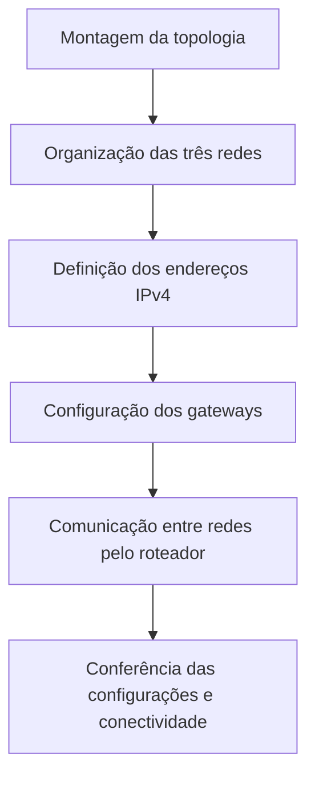

# Roteamento entre redes IPv4 no Cisco Packet Tracer

## Visão geral

Neste laboratório, foi montada uma topologia no Cisco Packet Tracer para estudar a comunicação entre três redes IPv4 utilizando um roteador Cisco 2911 e três switches Cisco 2960-24TT.

A atividade aborda endereçamento IPv4, gateway padrão e o papel do roteador na comunicação entre redes diferentes.

---

## Objetivos

- Organizar três segmentos de rede com faixas de endereços diferentes.
- Compreender a função dos switches e do roteador.
- Configurar endereços IPv4 estáticos e gateways, conforme o exercício.
- Estudar como o tráfego é encaminhado entre redes.

---

## Onde esse conhecimento pode ser aplicado?

**Cenário fictício: comunicação entre setores**

**Situação:** uma empresa organiza os computadores do Financeiro, Comercial e Operações em redes diferentes. Os funcionários precisam acessar determinados recursos de outros setores.

**Aplicação:** um roteador pode permitir a comunicação entre essas redes, desde que o endereçamento e os gateways estejam corretos. Regras de segurança adicionais podem limitar quais acessos são permitidos.

**Benefício e relação com o laboratório:** entender o roteamento ajuda a organizar a rede e investigar problemas de conectividade entre setores. O cenário é ilustrativo e não representa uma implantação real.

---

## Configurações de rede

| Segmento | Rede informada | Gateway informado | Máscara informada |
|---|---|---|---|
| Rede A | `10.0.0.0/8` | `10.0.0.1` | `255.0.0.0` |
| Rede B | `172.16.0.0/16` | `172.16.0.1` | `255.240.0.0` |
| Rede C | `192.168.1.0/24` | `192.168.1.1` | `255.255.255.0` |

**Atenção à Rede B:** o prefixo `/16` corresponde à máscara `255.255.0.0`, enquanto `255.240.0.0` corresponde a `/12`. É necessário conferir qual máscara foi aplicada no Packet Tracer antes de tratar esses valores como uma configuração consistente.

### Roteador Cisco 2911

| Segmento conectado | Gateway informado | Interface física |
|---|---|---|
| Rede A | `10.0.0.1` | Não informada |
| Rede B | `172.16.0.1` | Não informada |
| Rede C | `192.168.1.1` | Não informada |

Os gateways acima constam na descrição do laboratório. A associação a interfaces específicas do roteador depende da conferência do arquivo da simulação.

### Switches Cisco 2960-24TT

| Equipamento | Segmento atendido | Função |
|---|---|---|
| Switch da Rede A | Rede A | Conectar os dispositivos locais. |
| Switch da Rede B | Rede B | Conectar os dispositivos locais. |
| Switch da Rede C | Rede C | Conectar os dispositivos locais. |

Não foram fornecidas configurações individuais de portas ou VLANs.

### Computadores PC-PT

Os computadores representam os dispositivos finais dos três segmentos. Seus endereços IPv4, máscaras e gateways individuais precisam ser conferidos no arquivo do Packet Tracer antes de serem documentados.

## Etapas da atividade

1. Montagem da topologia com um roteador central, três switches e computadores.
2. Organização dos dispositivos em três segmentos IPv4.
3. Definição das faixas de endereçamento e dos gateways de cada rede.
4. Estudo da comunicação entre segmentos por meio do roteador.

A descrição recebida menciona diagnóstico com ICMP, mas não apresenta comandos, capturas ou resultados dos testes.

## Fluxograma

---

## Testes e resultados

| Verificação | Objetivo |
|---|---|---|
| Conferência dos endereços IPv4 | Verificar a configuração de cada segmento. |
| Conferência da máscara da Rede B | Resolver a divergência entre `/16` e `255.240.0.0`. |
| Teste ICMP entre redes | Verificar se computadores de redes diferentes conseguem se comunicar. |

---

## Conhecimentos adquiridos

A atividade ajuda a compreender a diferença entre a comunicação local, realizada por meio dos switches, e a comunicação entre redes, encaminhada pelo roteador. Também reforça a importância de configurar corretamente o endereço IPv4, a máscara e o gateway padrão de cada dispositivo.

Esses conhecimentos são úteis no Suporte de TI para investigar situações em que um computador acessa dispositivos da própria rede, mas não consegue alcançar recursos de outro segmento.

## Entendendo os termos técnicos

| Termo | O que significa? |
|---|---|
| IPv4 | Endereço numérico utilizado para identificar um dispositivo em uma rede. |
| Roteador | Equipamento que encaminha informações entre redes diferentes. |
| Switch | Equipamento que conecta dispositivos dentro de uma rede local. |
| Gateway padrão | Endereço utilizado pelo computador para alcançar outras redes. |
| Máscara de rede | Informação que ajuda a identificar qual parte do endereço pertence à rede. |
| Sub-rede | Parte de uma rede organizada em uma faixa de endereços. |
| ICMP | Protocolo usado em verificações de conectividade, como o comando `ping`. |
| CIDR | Forma de indicar o tamanho de uma rede usando prefixos como `/8`, `/16` e `/24`. |

