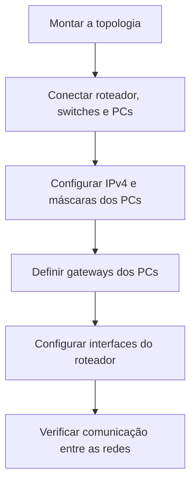

# Roteamento entre três redes IPv4

## Visão geral

Neste laboratório do Programa Mulher Digital, utilizei o **Cisco Packet Tracer** para estudar a comunicação entre três redes IPv4 distintas. A topologia do exercício reúne um roteador **Cisco 2911**, três switches **Cisco 2960** e seis computadores, distribuídos em três redes.

O objetivo foi compreender como configurar endereços IPv4, máscaras e gateways e como o roteador permite a comunicação entre dispositivos de redes diferentes.

---

## Objetivos

- Montar uma topologia com três redes conectadas a um roteador central.
- Conectar os computadores aos switches e os switches ao roteador.
- Configurar endereços IPv4 estáticos, máscaras e gateways.
- Entender a diferença entre a comunicação dentro de uma rede e entre redes distintas.
- Estudar a verificação de conectividade usando ICMP.

---

## Topologia

Cada rede possui dois computadores ligados a um switch. Os três switches estão conectados ao roteador central.

---

## Etapas da atividade

1. Adicionar um roteador Cisco 2911 e renomeá-lo para **Roteador**.
2. Adicionar três switches Cisco 2960: **Switch A**, **Switch B** e **Switch C**.
3. Adicionar seis computadores, dois para cada rede.
4. Organizar a topologia em três segmentos.
5. Conectar os switches ao roteador e os computadores aos respectivos switches.
6. Configurar os endereços IPv4, máscaras e gateways dos computadores.
7. Configurar e habilitar as três interfaces do roteador.
8. Verificar a comunicação entre computadores de redes diferentes.

---

## Fluxograma da atividade

---

## Onde esse conhecimento pode ser aplicado?

**Cenário fictício: comunicação entre setores de uma empresa**

Uma empresa possui três setores: **Financeiro**, **Comercial** e **Operações**. Cada setor utiliza uma rede própria para organizar seus computadores.

Um dia, o Comercial precisa consultar um recurso do Financeiro, mas os computadores estão em redes diferentes. O profissional de TI verifica os endereços, as máscaras e os gateways e utiliza o roteador para permitir a comunicação entre os setores.

**Resultado esperado:** os computadores conseguem trocar informações entre as redes, desde que a configuração esteja correta e não existam regras bloqueando o acesso.

**O que o laboratório ensina:** redes diferentes podem se comunicar por meio de um roteador. Essa separação organiza o ambiente, mas **não garante segurança ou restrição de acesso por si só**; controles adicionais podem ser necessários.

---

## Configurações realizadas no exercício

### Resumo do endereçamento

| Rede | Endereço de rede | Máscara | Prefixo CIDR | Gateway |
|---|---|---|---|---|
| Rede A | `10.0.0.0` | `255.0.0.0` | `/8` | `10.0.0.1` |
| Rede B | `172.16.0.0` | `255.255.0.0` | `/16` | `172.16.0.1` |
| Rede C | `192.168.1.0` | `255.255.255.0` | `/24` | `192.168.1.1` |

---

### Roteador Cisco 2911

O roteador utiliza uma interface para cada rede. No material da atividade, as interfaces são habilitadas (**On**) e recebem os seguintes endereços:

| Interface | Rede conectada | Endereço IPv4 | Máscara | Estado previsto |
|---|---|---|---|---|
| `GigabitEthernet0/0` | Rede A | `10.0.0.1` | `255.0.0.0` | On |
| `GigabitEthernet0/1` | Rede B | `172.16.0.1` | `255.255.0.0` | On |
| `GigabitEthernet0/2` | Rede C | `192.168.1.1` | `255.255.255.0` | On |

---

### Computadores da Rede A

| Computador | IPv4 | Máscara | Gateway |
|---|---|---|---|
| PC A1 | `10.0.0.2` | `255.0.0.0` | `10.0.0.1` |
| PC A2 | `10.0.0.3` | `255.0.0.0` | `10.0.0.1` |

---

### Computadores da Rede B

| Computador | IPv4 | Máscara | Gateway |
|---|---|---|---|
| PC B1 | `172.16.0.2` | `255.255.0.0` | `172.16.0.1` |
| PC B2 | `172.16.0.3` | `255.255.0.0` | `172.16.0.1` |

---

### Computadores da Rede C

| Computador | IPv4 | Máscara | Gateway |
|---|---|---|---|
| PC C1 | `192.168.1.2` | `255.255.255.0` | `192.168.1.1` |
| PC C2 | `192.168.1.3` | `255.255.255.0` | `192.168.1.1` |

---

Em cada computador, acessar **Desktop > IP Configuration** e preencher os campos de endereço IPv4, máscara e gateway.

---

### Conexões do roteador aos switches

O material orienta utilizar o cabo **Copper Straight-Through** nas conexões.

| Origem (roteador) | Destino (switch) |
|---|---|
| `GigabitEthernet0/0` | Switch A — `FastEthernet0/1` |
| `GigabitEthernet0/1` | Switch B — `FastEthernet0/1` |
| `GigabitEthernet0/2` | Switch C — `FastEthernet0/1` |

---

### Conexões dos computadores aos switches

| Computador / porta | Switch / porta | Rede |
|---|---|---|
| PC A1 — `FastEthernet0` | Switch A — `FastEthernet0/2` | A |
| PC A2 — `FastEthernet0` | Switch A — `FastEthernet0/3` | A |
| PC B1 — `FastEthernet0` | Switch B — `FastEthernet0/2` | B |
| PC B2 — `FastEthernet0` | Switch B — `FastEthernet0/3` | B |
| PC C1 — `FastEthernet0` | Switch C — `FastEthernet0/2` | C |
| PC C2 — `FastEthernet0` | Switch C — `FastEthernet0/3` | C |

---

## Testes e resultados

O slide da **etapa 13** apresenta um exemplo de verificação de conectividade no Packet Tracer: um pacote **ICMP** enviado do **PC A2** ao **PC B2**, com indicação **Successful** na janela de eventos da simulação ilustrada.

| Verificação | O que permite observar | Evidência disponível |
|---|---|---|
| Endereçamento dos PCs | Se cada computador pertence à rede planejada. | Configurações especificadas nos slides. |
| Interfaces do roteador | Se existe um gateway previsto para cada rede. | Endereços e interfaces especificados nos slides. |
| ICMP entre Rede A e Rede B | Se dispositivos em redes distintas conseguem trocar pacotes. | Exemplo visual de sucesso entre PC A2 e PC B2 no slide 18. |
| Testes adicionais entre todas as redes | Se a conectividade funciona em todos os pares. | Não há resultados individuais documentados no material. |

**Importante:** o sucesso mostrado no slide é uma referência da atividade; sem registros da execução individual ou acesso ao arquivo `.pkt`, ele não comprova, por si só, o resultado da minha própria simulação.

## Conhecimentos adquiridos

- **Endereçamento IPv4:** cada computador precisa de um endereço compatível com a rede à qual pertence.
- **Máscara de rede:** define quais endereços fazem parte do mesmo segmento.
- **Gateway padrão:** indica para onde o computador envia tráfego destinado a outras redes.
- **Switch e roteador:** o switch conecta equipamentos dentro de um segmento, enquanto o roteador interliga redes diferentes.
- **Diagnóstico de conectividade:** testes ICMP ajudam a investigar falhas de comunicação.

Esses conhecimentos são úteis em **Suporte de TI e Redes** para investigar situações em que um computador consegue acessar equipamentos locais, mas não recursos de outro setor.

## Entendendo os termos técnicos

| Termo | Explicação simples |
|---|---|
| IPv4 | Endereço que identifica um equipamento na rede. |
| Switch | Equipamento que conecta computadores dentro de uma rede local. |
| Roteador | Equipamento que permite a comunicação entre redes diferentes. |
| Gateway padrão | Caminho de saída usado pelo computador para chegar a outras redes. |
| Máscara de rede | Indica quais endereços pertencem à mesma rede. |
| Interface | Porta de comunicação de um equipamento de rede. |
| ICMP | Protocolo utilizado em testes de conectividade, como o `ping`. |
| CIDR | Notação que representa o tamanho de uma rede, como `/8`, `/16` e `/24`. |
| Copper Straight-Through | Tipo de cabo de rede utilizado para conectar os dispositivos na simulação. |

---

## Origem do laboratório

Atividade do **Programa Mulher Digital**, sobre comunicação entre três redes distintas no Cisco Packet Tracer. Documentação organizada para registrar os conceitos e configurações estudados, sem representar uma implantação corporativa.
